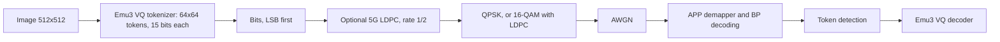
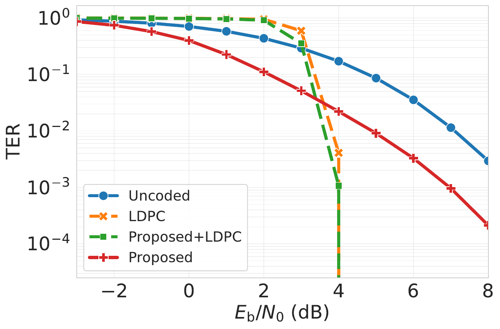
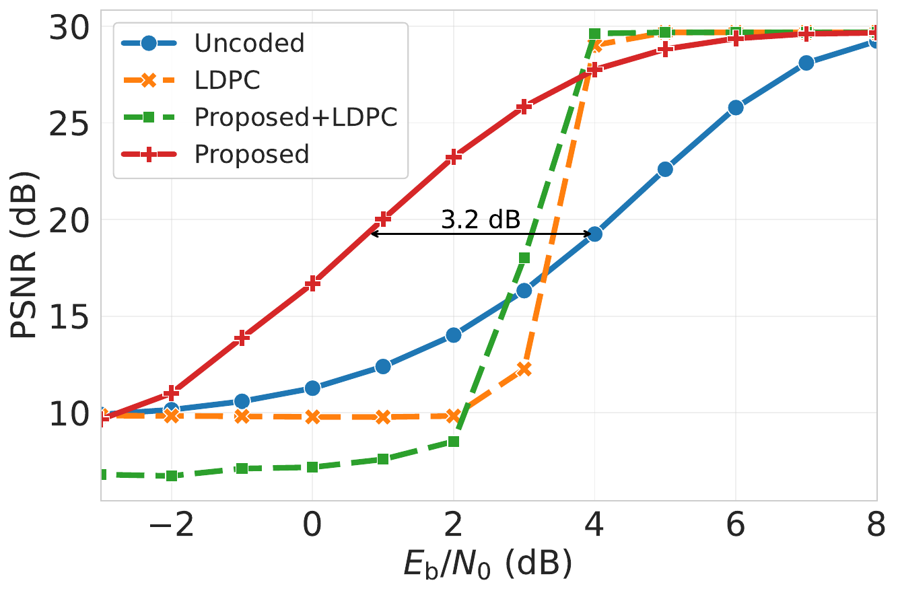
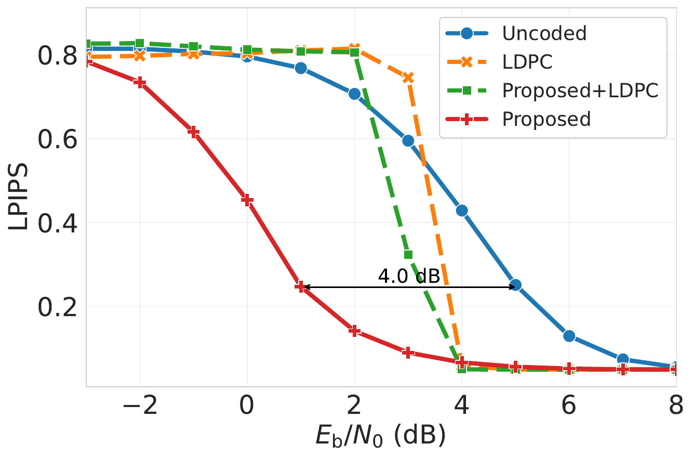
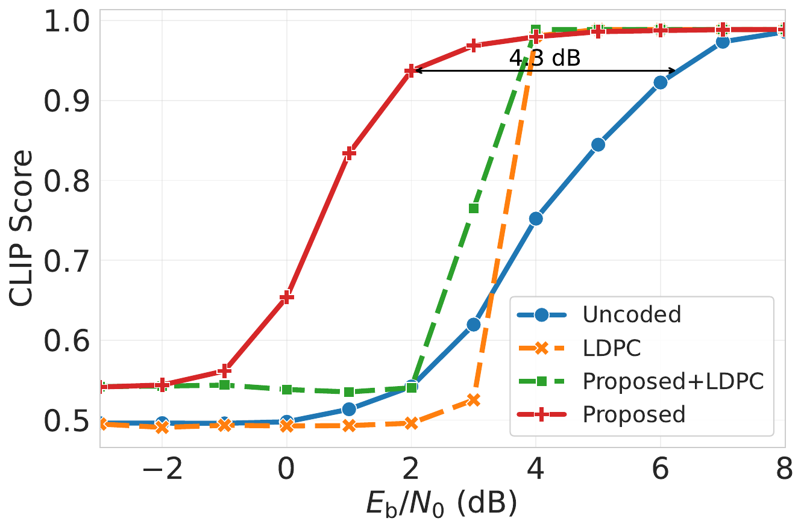
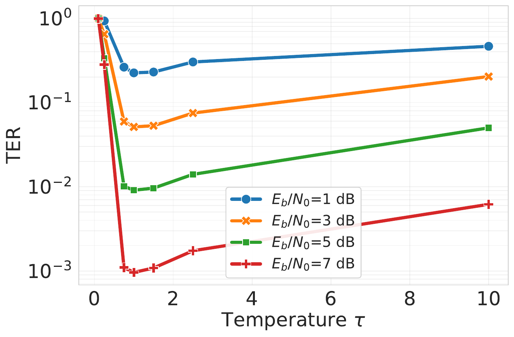

# Contextual Soft-Decision Token Detection via LMM-Based Generative Semantic Prior

Code and results for the paper:

R. Ishizuka, A. E. Kalør, and T. Ohtsuki, "Contextual Soft-Decision Token Detection via LMM-Based Generative Semantic Prior," IEEE Global Communications Conference (GLOBECOM), 2026.

In token communication, an image is converted into discrete tokens by a tokenizer and the tokens are sent over a wireless channel. This repository implements a receiver that detects each token by fusing the physical-layer log-likelihood ratios (LLRs) with a contextual prior from a large multimodal model (LMM). The transmitter needs only the tokenizer, not the LMM.

## Method

The simulated link is:



Tokens are detected one at a time in raster order (greedy). At position $i$ the receiver chooses

$$
\hat{s}_i = \arg\max_k \left[ \log P(\mathbf{y}_i \mid s_i = k) + \frac{o_{i,k}}{\tau} \right],
$$

where $\log P(\mathbf{y}_i \mid s_i = k)$ is the token log-likelihood computed from the 15 bit LLRs of token $i$, $o_{i,k}$ is the logit of visual token $k$ predicted by Emu3-Gen given the previously detected tokens, and $\tau$ is a temperature (larger $\tau$ weakens the prior). The hard-decision baseline uses only the LLRs.

The LMM attends to the text prefix and to the last $W$ image tokens only (sliding-window attention, `emu3.window_size`). This is implemented in the vendored `src/models/third_party/modeling_emu3.py`.

## Results

All results below use 100 FFHQ images at 512x512 and are produced from the recorded runs in `results/sweeps/` (see [Reproducing the paper](#reproducing-the-paper)). *Uncoded* and *LDPC* are hard-decision baselines; *Proposed* uses the LMM prior with $\tau = 1$ and $W = 4096$, and *Proposed+LDPC* applies it to the LLRs after LDPC decoding. The LDPC curves use 16-QAM.

### Token error rate



Without channel coding, the LMM prior lowers the token error rate (TER) over the whole $E_b/N_0$ range. At 3 dB, for example, TER drops from 0.292 to 0.051.

### Reconstructed image quality

| PSNR (higher is better) | LPIPS (lower is better) | CLIP score (higher is better) |
| --- | --- | --- |
|  |  |  |

Between 1 dB and 5 dB, the proposed detector improves PSNR by up to 9.5 dB, reduces LPIPS by up to 85% and increases the CLIP score by up to 73% compared with uncoded hard decision. The arrows mark the largest $E_b/N_0$ gain at equal quality.

### Temperature



TER is lowest around $\tau = 1$. A small $\tau$ lets the prior override the channel, and a large $\tau$ removes its benefit.

### Attention window

TER of the proposed detector for different attention windows $W$ (number of preceding image tokens the LMM attends to):

| $E_b/N_0$ (dB) | $W = 10$ | $W = 128$ | $W = 512$ | $W = 4096$ |
| --- | --- | --- | --- | --- |
| 1 | 0.349 | 0.263 | 0.237 | 0.225 |
| 3 | 0.124 | 0.063 | 0.054 | 0.051 |
| 5 | 0.028 | 0.011 | 0.009 | 0.009 |
| 7 | 0.004 | 0.001 | 0.001 | 0.001 |

A longer context gives a better prior. Most of the gain is already reached at $W = 512$ (8 rows of 64 tokens).

## Repository layout

```text
config.yaml                  Hydra configuration (defaults of the paper: tau=1, W=4096)
src/
├── main.py                  runs one simulation and writes avg_metrics.csv
├── models/
│   ├── transmitter.py       image -> VQ tokens -> bits
│   ├── channel.py           LDPC (optional), QPSK, AWGN, demapping, BP decoding (Sionna)
│   ├── receiver.py          hard decision or LMM-based detection, then VQ decoding
│   ├── emu3.py              Emu3 wrapper and the proposed detector (Emu3SoftDecoder)
│   ├── base.py              bit/token conversion, modulation and LDPC blocks
│   └── third_party/         vendored Emu3 code (Apache-2.0) with sliding-window attention
├── data/dataset.py          FFHQ loader
└── utils/                   preprocessing, metrics (PSNR, SSIM, LPIPS, CLIP score, FID), logging
scripts/
├── reproduce_paper.sh       regenerate the figures/table, or rerun all experiments
├── analyze_sweep.py         plots from a directory of runs
└── paper_window_table.py    TER vs window size table
results/
├── sweeps/                  per-run avg_metrics.csv and Hydra overrides of every run in the paper
└── figures/                 the figures as they appear in the paper
tests/                       unit test of the sliding-window attention (CPU, no download)
```

## Installation

Tested with Python 3.10, PyTorch 2.2.1, TensorFlow 2.15 and Sionna 0.19 on Linux.

```bash
python -m venv .venv
source .venv/bin/activate
pip install -r requirements.txt
```

Install the PyTorch build that matches your CUDA version first if the default wheel does not fit. Sionna runs on TensorFlow and the models run on PyTorch, both on the same GPU. TensorFlow memory growth is enabled in `src/main.py`.

The models are downloaded from the Hugging Face Hub on first use:

- [`BAAI/Emu3-VisionTokenizer`](https://huggingface.co/BAAI/Emu3-VisionTokenizer) (VQ tokenizer)
- [`BAAI/Emu3-Gen`](https://huggingface.co/BAAI/Emu3-Gen) (LMM prior, about 8B parameters, bf16)
- `openai/clip-vit-base-patch16` and the LPIPS AlexNet weights (metrics)

The LMM-based detector needs a GPU with enough memory for Emu3-Gen in bf16 (about 17 GB) plus the KV cache for a batch of 5 images. The hard-decision baseline also runs on a CPU.

## Data

The paper uses 100 images of [FFHQ](https://github.com/NVlabs/ffhq-dataset) at 512x512. Put the images in one directory as `00000.png`, `00001.png`, ... and set `dataset.path` (default `~/datasets/ffhq_512`). The images are read in file-name order and the first `num_images` images are used.

FFHQ is not included in this repository. See its license (CC BY-NC-SA 4.0).

## Reproducing the paper

### Figures and table from the recorded results

No GPU and no dataset are needed. This takes less than a minute:

```bash
bash scripts/reproduce_paper.sh figures
```

The script writes the figures to `outputs/paper_figures/sweeps/` and prints the window-size table. The PDF figures are pixel-identical to `results/figures/*.pdf`; the PNG files there are 150 dpi renderings for this page.

| Paper item | Recorded sweep | Output |
| --- | --- | --- |
| TER, PSNR, LPIPS, CLIP score vs $E_b/N_0$ | `results/sweeps/sweep_20260413_095050_` | `snr/vs_snr/*_vs_snr.pdf` |
| TER vs $\tau$ | `results/sweeps/sweep_20260414_174518__tau_sweep` | `tau/vs_tau/ter_vs_tau.pdf` |
| Table: TER vs window size $W$ | `results/sweeps/sweep_20260416_133456__window` | printed as LaTeX rows |

### Rerunning the experiments

This reruns every recorded run with its Hydra overrides (100 images each). It needs a GPU and takes a long time, because the LMM is evaluated once per token (4096 steps per batch):

```bash
DATASET_PATH=/path/to/ffhq_512 bash scripts/reproduce_paper.sh run                                 # all sweeps
DATASET_PATH=/path/to/ffhq_512 bash scripts/reproduce_paper.sh run sweep_20260416_133456__window   # one sweep
bash scripts/reproduce_paper.sh figures outputs/paper_repro
```

Finished runs are skipped, so an interrupted rerun can be resumed. Results are written to `outputs/paper_repro/<sweep>/<run>/`.

The random seed is fixed (`seed: 42`), but the detected tokens depend on the hardware and on numerical details (bf16 inference of the LMM and the tokenizer). A rerun on different hardware reproduces the curves statistically, not token by token.

### Settings of the recorded runs

| Item | Value |
| --- | --- |
| Images | FFHQ, first 100 images, 512x512, batch size 5 |
| Detection | greedy, KV cache, $\tau = 1$ and $W = 4096$ unless swept |
| Uncoded | QPSK |
| Coded | 5G NR LDPC, rate 1/2, 20 BP iterations, 16-QAM (run directories ending in `_bps4`). The sweep also contains LDPC runs with QPSK, which are not plotted. |

## Running a single simulation

```bash
python src/main.py                                                   # proposed method, Eb/N0 = 3 dB, 5 images
python src/main.py receiver.use_llm=false channel.snr=1              # hard-decision baseline
python src/main.py channel.use_ldpc=true channel.num_bits_per_symbol=4 receiver.num_bits_per_symbol=4 channel.snr=1
python src/main.py receiver.temperature=2.0 emu3.window_size=512
```

Main options (see `config.yaml`):

| Key | Meaning |
| --- | --- |
| `channel.snr` | $E_b/N_0$ in dB (per information bit) |
| `channel.use_ldpc` | 5G NR LDPC, rate 1/2, 20 BP iterations |
| `channel.num_bits_per_symbol`, `receiver.num_bits_per_symbol` | 2: QPSK, 4: 16-QAM (set both) |
| `receiver.use_llm` | `true`: proposed detector, `false`: hard-decision baseline |
| `receiver.temperature` | $\tau$ |
| `emu3.window_size` | attention window $W$ over image tokens |
| `num_images` | number of images (`-1` for all) |

Each run writes to a Hydra directory `outputs/<date>/<time>/`:

| File | Content |
| --- | --- |
| `avg_metrics.csv` | TER, BER, PSNR, SSIM, LPIPS, CLIP score, FID and the run settings, averaged over batches |
| `token_correct.npy` | per-token correctness flags |
| `results/recon_*.png` | reconstructed images (`save_images=true`) |
| `main.log` | log |

FID is computed over only `num_images` images and is not used in the paper.

## Tests

```bash
python -m unittest discover tests
```

The test checks on a small random model that tokens outside the attention window do not affect the prediction, with and without the KV cache.

## License

The code in this repository is licensed under the [Apache License 2.0](LICENSE).

The files in `src/models/third_party/` are from [Emu3](https://huggingface.co/BAAI/Emu3-Gen) (Copyright 2024 The Emu team, BAAI and The HuggingFace Inc. team, Apache License 2.0). `modeling_emu3.py` has been modified, see [NOTICE](NOTICE). The Emu3 model weights, FFHQ, CLIP and LPIPS are subject to their own licenses.
